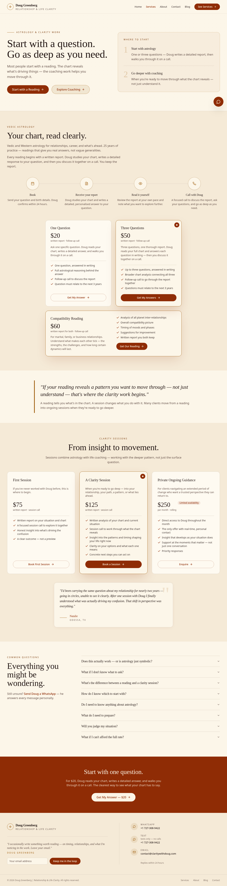
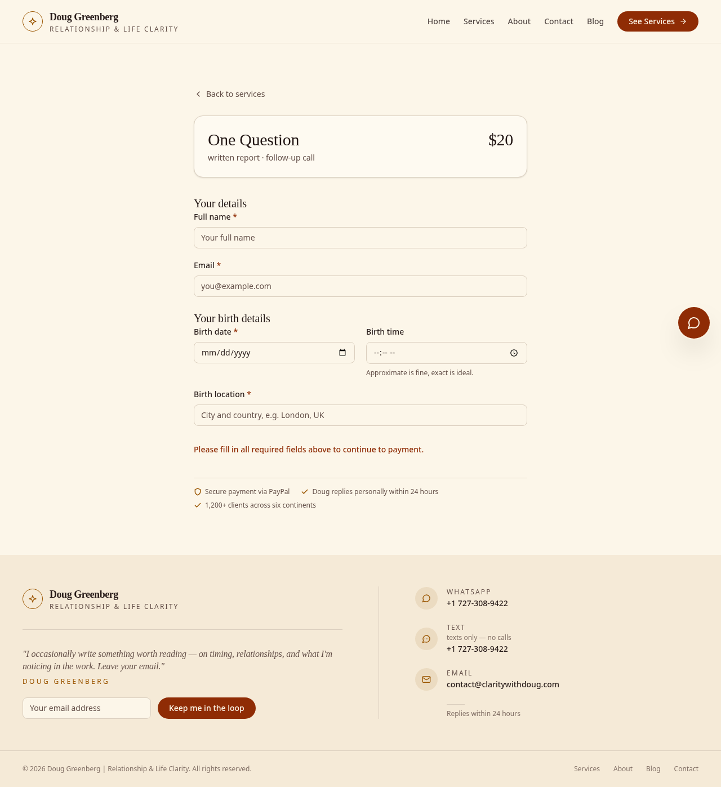

# Clarity with Doug — sold client site (portfolio piece)

Live site: **https://claritywithdoug.com**

Static Astro site for Doug Greenberg, a relationship & life-clarity coach (Vedic + Western astrology, life coaching). Designed, built, and shipped to production — including PayPal checkout, contact/booking flows, SEO/structured data, and analytics wiring. Kept as a public portfolio example of a real, revenue-adjacent client build.

> **Privacy note:** this repo's working tree carries no live secrets. PayPal / Web3Forms / GTM values load from environment variables (see `.env.example`). Client contact details (phone, email, WhatsApp) are intentionally part of the site content — it's a live business site. Git history still contains pre-sanitization secrets: **do not treat history as clean** — see `docs/public-release-plan.md`.

## Screenshots

| Page | Screenshot |
|---|---|
| Homepage hero |  |
| Services |  |
| Checkout |  |

Live site is the source of truth — https://claritywithdoug.com

### Re-capturing screenshots

No headless browser is vendored in this repo, so re-capture manually
after major visual changes:

1. `bun install && cp .env.example .env && bun run build && bun run preview`
2. Open `http://localhost:4321/` — full-page screenshot → save as `public/screenshots/home-hero.png`
3. Open `/services` → `public/screenshots/services.png`
4. Open `/checkout?product=one-question` → `public/screenshots/checkout.png`
5. Commit the PNGs and update the table above to embed them.

Headless alternative (if Chromium/Playwright is available):

```bash
npx -y playwright screenshot --viewport-size=1440,900 --full-page \
  http://localhost:4321/ public/screenshots/home-hero.png
npx -y playwright screenshot --viewport-size=1440,900 --full-page \
  http://localhost:4321/services public/screenshots/services.png
npx -y playwright screenshot --viewport-size=1440,900 \
  "http://localhost:4321/checkout?product=one-question" public/screenshots/checkout.png
```

## Stack

- **Astro 6** + TypeScript (static output, no backend)
- **Tailwind CSS v4** (+ `@tailwindcss/typography`)
- **Bun** (install/build/preview)
- Self-hosted fonts (`@fontsource-variable/inter`, `playfair-display`)
- Integrations: `@astrojs/sitemap`
- Third parties (all keyed via env): **PayPal JS SDK** (checkout), **Web3Forms** (contact + checkout order email), **Google Tag Manager** (analytics, optional)

## Quickstart

```bash
bun install
cp .env.example .env   # fill in real keys for full checkout/contact behavior
bun run dev            # http://localhost:4321
bun run build          # static output in dist/
bun run preview        # serve dist/ locally
```

### Env setup

| Var | Used in | Notes |
|---|---|---|
| `PUBLIC_PAYPAL_CLIENT_ID` | `src/components/CheckoutForm.astro` | PayPal client ID. Falls back to `"sb"` (sandbox) when unset so local build works. |
| `PUBLIC_WEB3FORMS_CHECKOUT_KEY` | `src/components/CheckoutForm.astro` | Order-notification key. Placeholder fallback for local dev. |
| `PUBLIC_WEB3FORMS_CONTACT_KEY` | `src/components/ContactForm.astro` | Contact-form key. Placeholder fallback for local dev. |
| `PUBLIC_GTM_ID` | `src/layouts/Base.astro` | GTM container (e.g. `GTM-XXXXXXX`). Empty = GTM snippet omitted entirely. |

`.env` is gitignored (see `.gitignore`). Production values are injected at build/deploy time (CI secrets / host env) — never committed. `GTM_CONF_TODO.md` documents the GTM→GA4 tag setup with a placeholder ID.

## Structure

```
src/
  pages/          index.astro  services.astro  about.astro  contact.astro
                  checkout.astro  astro.astro (redirect → /services)  blog/
  components/     CheckoutForm.astro  ContactForm.astro  Header/Footer/StickyContact
  layouts/        Base.astro (head, SEO, schema, GTM)  BlogPost.astro
  lib/            offers.ts (products/pricing)
  content/blog/   Markdown posts (content collections)
  styles/         global.css (Tailwind v4 tokens)
public/           favicon, og image, robots.txt, llms.txt, screenshots/
```

Key flows:

- `/services` → product cards link to `/checkout?product=<slug>`
- `/checkout` → validates birth-details form → renders PayPal buttons → on capture, POSTs order to Web3Forms
- `/contact` → WhatsApp deep-link (default) or Web3Forms email path with honeypot
- Footer newsletter → `mailto:` compose (no backend)

## Deploy

- Push to `main` → `.github/workflows/deploy.yml` builds with Astro and FTP-deploys `dist/` to Hostinger (`/public_html/`). FTP credentials live in GitHub Secrets (clean — keep).
- Set the four `PUBLIC_*` vars as build-time env in CI/hosting before going live; without them the site builds but PayPal/Web3Forms/GTM run on sandbox/placeholder/disabled behavior.
- `astro.config.mjs`: `site: https://claritywithdoug.com`, sitemap excludes `/checkout`, `/astro` → `/services` redirect.

## Accessibility / SEO

- Skip-to-content link, semantic landmarks (`header`/`main`/`footer`), labeled required fields, `aria-live` form status regions, focus-visible rings, honeypot `botcheck` (not CAPTCHA-gated).
- Canonical URLs, per-page title/description, OG + Twitter cards, sitemap, `robots.txt`.
- JSON-LD `Organization` / `WebSite` / `Person` graph in `Base.astro`; page-level `schema` prop for extras.
- GA4-via-GTM `dataLayer` events: `cta_clicked`, `whatsapp_click`, `phone_click`, `email_click`, `form_submitted`, `begin_checkout`, `purchase`.

## Public-release status (portfolio use)

- [x] Working-tree secrets moved to env
- [ ] **BLOCKED — history still contains live keys + PII across ~203 commits; force-push + key rotation required before making the repo public** — exact commands in `docs/public-release-plan.md`
- [ ] Screenshots captured into `public/screenshots/`
- [ ] Optional: lowercase repo rename `Clarity-with-Doug` → `clarity-with-doug` (GitHub UI; local-only change here)
